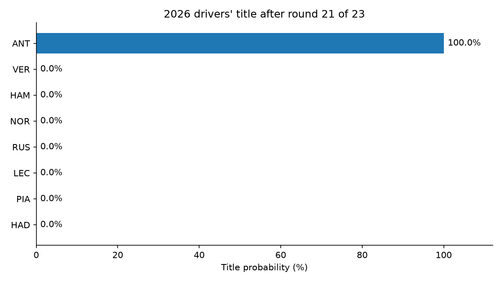

# F1 Championship Prediction

Who will win the Formula 1 world championship, and how sure can we be after each race?

This project answers that in two ways and checks both against twelve past seasons:

- **A season simulation** (the headline model): play out the remaining races thousands of times and count how often each driver and team finishes on top.
- **An LSTM classifier** (PyTorch), kept as a comparison: a neural network that reads each driver's season so far and outputs a title probability.

The standings are rebuilt every Monday from the official results by a GitHub Action, and the sections marked as generated below are rendered from results files. A test fails if the README and those files disagree.

## Current prediction

<!-- prediction:start -->
**2026 season after round 21 of 23 (Las Vegas Grand Prix).** 2 rounds left, of which 0 are sprint weekends; a driver can still score at most 50 points.

**ANT has won the 2026 drivers' championship**: the lead is larger than the points still available.

| Driver | Team | Points | Title probability |
|---|---|---|---|
| ANT | Mercedes | 402 | 100.0% |
| VER | Red Bull | 304 | 0.0% |
| HAM | Ferrari | 267 | 0.0% |
| NOR | McLaren | 264 | 0.0% |
| RUS | Mercedes | 264 | 0.0% |
| LEC | Ferrari | 250 | 0.0% |

| Team | Points | Constructors' title probability |
|---|---|---|
| Mercedes | 666 | 100.0% |
| Ferrari | 517 | 0.0% |
| Red Bull | 440 | 0.0% |
| McLaren | 431 | 0.0% |

From 20,000 simulated seasons. Drivers not shown are at or near 0%.
<!-- prediction:end -->



## How good are the predictions?

Each method was replayed through past seasons, using only what was known after each round.

<!-- backtest:start -->
Seasons 2014–2025, one prediction after every round from round 4 to the second-last: 204 predictions per method.

| All seasons | Top pick was the champion | Probability given to the champion | Brier score (lower is better) |
|---|---|---|---|
| Season simulation | 75.5% | 74.9% | 0.350 |
| Points leader wins | 77.0% | 77.0% | 0.461 |
| LSTM classifier | 59.3% | 49.5% | 0.469 |

By stage of the season (Brier score, lower is better):

| Stage | Predictions | Season simulation | Points leader wins | LSTM classifier |
|---|---|---|---|---|
| First third | 45 | 0.457 | 0.622 | 0.598 |
| Middle third | 83 | 0.483 | 0.675 | 0.492 |
| Final third | 76 | 0.141 | 0.132 | 0.369 |

By season (how often the top pick was the eventual champion):

| Season | Champion | Season simulation | Points leader wins | LSTM classifier |
|---|---|---|---|---|
| 2014 | HAM | 40% | 40% | 0% |
| 2015 | HAM | 100% | 100% | 100% |
| 2016 | ROS | 76% | 76% | 100% |
| 2017 | HAM | 44% | 44% | 12% |
| 2018 | HAM | 82% | 82% | 29% |
| 2019 | HAM | 94% | 94% | 71% |
| 2020 | HAM | 100% | 100% | 77% |
| 2021 | VER | 67% | 78% | 28% |
| 2022 | VER | 89% | 89% | 22% |
| 2023 | VER | 100% | 100% | 100% |
| 2024 | VER | 100% | 100% | 100% |
| 2025 | NOR | 20% | 25% | 65% |
<!-- backtest:end -->

**What this shows.**

- The simulation picks the eventual champion about as often as the simplest possible rule, "whoever leads the standings wins". Picking the leader is hard to beat.
- Where the simulation helps is in how sure it is. The Brier score punishes confident wrong calls, and the simulation scores better than the leader rule because it hedges when the fight is close.
- The LSTM does worse than both across the full set, even though it was trained on 2014–2024, so those seasons are not new to it. 2025 was used to choose which training run to keep, so it has no season that is completely new to it. Its better showing in 2025 is one season and should not be read as more than that.
- All three struggle with seasons where the lead changed hands late (2014, 2017, 2021, 2025). Nothing here models car development or form swings.

**The scores.** "Top pick was the champion" is plain accuracy. "Probability given to the champion" is how much weight the method put on the driver who went on to win. The Brier score is the squared error of the whole probability table: 0 is a perfect call and 2 is a certain wrong one.

## How the simulation works

Each remaining round is filled in with a round already run this season, drawn at random. Every driver and team gets the points they really scored in the drawn round. Do this for every remaining round, add the points to the current standings, and note who finishes on top. Repeat 20,000 times.

This keeps the result honest in ways a per-driver classifier cannot:

- **Probabilities add up to 100%**, because each simulated season has exactly one champion.
- **A driver who cannot catch up gets 0%**, because nobody can score more in a simulated round than someone really scored in a round. The README also states the plain arithmetic: once the lead is larger than the points still available, the title is decided.
- **Points within a round stay consistent.** Whole rounds are drawn, so two drivers cannot both win the same race.
- **Sprint weekends are drawn from past sprint weekends** when there are any, because more points are on offer.
- **Team points follow the team a driver was with at the time**, so mid-season driver changes do not move points between teams.

### Limitations

- It assumes the rest of the season looks like the season so far. It knows nothing about upgrades, driver changes or which circuits remain.
- Early in a season there are few rounds to draw from, so it can be overconfident after one team's strong start.
- Drivers level on points are split at random; the real tie-break is countback on wins.
- A driver's results are not separated from their car's. A parametric model of driver and car strength would be the next step.

## The LSTM classifier

```
Input per round (12 features): points and position (normalised), gap to leader,
win rate, podium rate, points per race, season progress, consistency,
momentum, is-leader flag, points share, recent form
        ↓
2-layer LSTM (hidden size 64, dropout 0.3)
        ↓
Linear → sigmoid: "does this driver win the title?"
```

53,313 parameters, trained with a class-weighted binary loss on 2014–2024, with 2025 used for early stopping.

Its design has a built-in weakness for this problem: each driver is scored on their own, so the outputs do not add up to one and the model cannot see that a rival is out of reach. The numbers in the backtest table are its outputs rescaled to sum to one.

The checkpoint in `models/` was trained on an earlier version of the dataset that left out sprint points. It has not been retrained on the corrected data, which is one more reason to treat it as a comparison and not as the model of record. `results/training_curves.png` and `results/model_architecture.png` are from that training run.

## Data

Race results, sprint results and calendars for 2014–2026 come from the [Jolpica API](https://api.jolpi.ca) (the successor to Ergast) and are stored in `data/season_results.csv` and `data/calendar.csv`.

`data/championship_standings.csv` is always rebuilt from the full list of results. It is never updated one round at a time, so a driver who misses a round keeps their points and a corrected result upstream corrects everything downstream.

## Running it

```bash
pip install -r requirements.txt

pytest                              # run the tests
python src/update_predictions.py    # refresh this season, re-simulate, update README and chart
python -m src.backtest              # replay 2014–2025 and write results/backtest.json
python src/train.py                 # retrain the LSTM (optional)
```

The prediction service in `api/` (FastAPI, with a Dockerfile) serves the LSTM classifier.

## Project structure

```
f1-championship-prediction/
├── src/
│   ├── results_data.py        # official results and calendar
│   ├── standings.py           # standings rebuilt from results
│   ├── season_simulation.py   # rest-of-season simulation
│   ├── backtest.py            # replay past seasons, score each method
│   ├── report.py              # prediction file and generated README blocks
│   ├── update_predictions.py  # weekly update entry point
│   └── model.py, dataset.py, feature_engineering.py, train.py, evaluate.py   # LSTM
├── data/                      # results, calendar, standings
├── results/                   # prediction.json, backtest.json, charts
├── api/                       # FastAPI service for the LSTM
├── notebooks/                 # original LSTM analysis notebook
└── tests/
```

The notebook and the constructor LSTM scripts (`train_constructor.py`, `update_constructor_predictions.py`) are from the original LSTM-only version of the project. The constructors' prediction now comes from the same simulation as the drivers'.

## Future work

- A driver-and-car strength model with uncertainty, in place of redrawing past rounds.
- Retrain the LSTM on the corrected data with each season held out in turn, so its backtest is a fair one.
- Countback on wins for ties.
